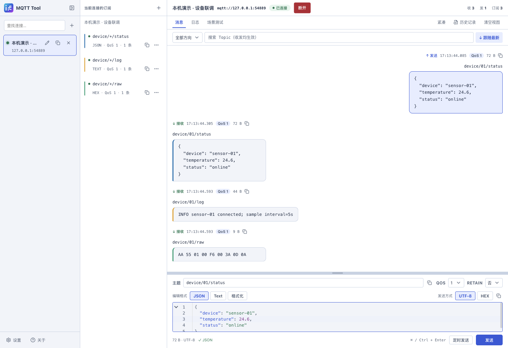
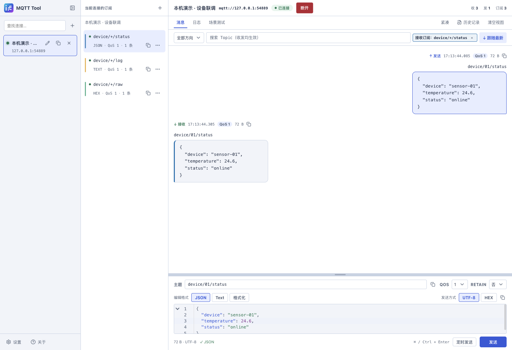
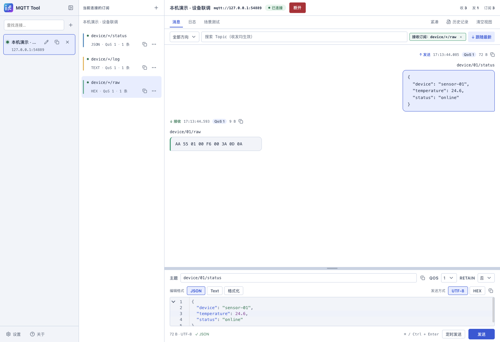
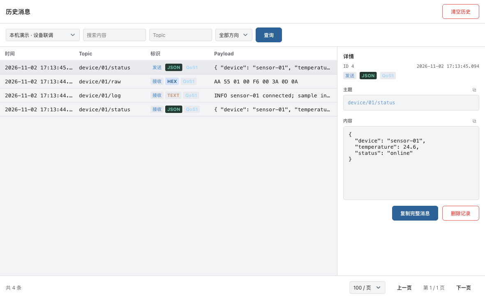
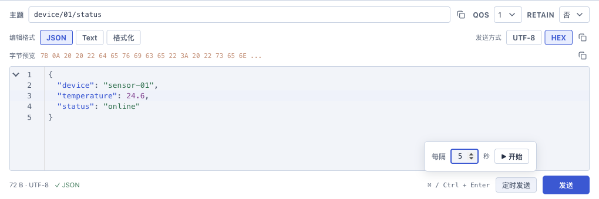
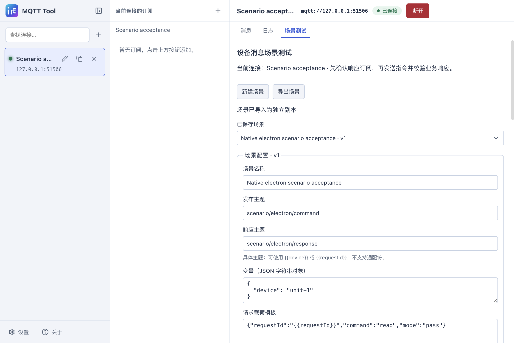

<p align="center"></p>

# Ineed MQTT Tool

面向物联网研发、设备联调与运维的 MQTT 桌面工作台。把连接、主题订阅、消息收发和设备响应验证放在一起，方便从“一条消息”追到“一次完整交互”。

[产品官网](https://mqtt.ineedfull.com/) · [下载安装](https://mqtt.ineedfull.com/downloads/) · [设备消息场景](docs/message-scenarios.md) · [开发指南](docs/development.md)

[](docs/images/readme/workbench.webp)

## 能帮你做什么

- **管理多个 Broker**：保存连接与订阅配置，按主题查看消息；支持 MQTT、TLS 与 WebSocket 接入。
- **按订阅主题区分消息格式**：同一个 Broker 连接下，每条订阅都可独立选择 JSON、Text 或 HEX，方便同时调试结构化数据、文本日志和二进制报文。
- **查看消息详情与历史**：核对完整载荷、发送与接收方向、QoS 和 Retain，追踪设备交互。
- **重复发送设备指令**：编辑主题与载荷、格式化 JSON，手动或定时发布，减少重复输入。
- **验证设备响应**：配置请求与响应主题、变量、请求 ID 和业务断言，保存场景并导出包含原始证据的 JSON 报告。
- **适应不同工作环境**：浅色/深色主题、大字模式、可折叠侧栏；Electron 与 Tauri 复用同一套 Vue 工作台。

## 按订阅主题独立选择消息格式

**消息格式配置在每条订阅上，同一个 Server / Broker 连接可以同时使用多种显示格式。** 例如，一个设备既上报 JSON 数据，又输出文本日志和二进制报文，可以在同一连接下这样订阅：

| 订阅主题 | 消息内容 | 显示格式 |
| --- | --- | --- |
| `devices/pump-01/telemetry` | 温度、压力等结构化数据 | JSON |
| `devices/pump-01/log` | 设备运行日志 | Text |
| `devices/pump-01/raw` | 原始二进制报文 | HEX |

添加订阅时，在「消息格式」中为该订阅选择合适的格式。相比按整个 Server 或连接统一设置格式的方式，这样可以让不同主题各用适合的展示方式，无需为了查看不同格式的消息再建立多个连接。

## 界面预览

点击图片查看原图。以下基础界面采集于 2026-11-02，场景界面采集于 2026-11-01，均来自隔离演示环境的 Electron 原生开发宿主。

| 按主题阅读 JSON | 检查二进制 HEX |
| --- | --- |
| [](docs/images/readme/topic-json.webp) | [](docs/images/readme/topic-hex.webp) |

| 消息历史与详情 | 定时发送配置 |
| --- | --- |
| [](docs/images/readme/history.webp) | [](docs/images/readme/scheduled-send.webp) |


设备消息场景可以把联调步骤保存下来，下次复测继续使用：

[](docs/images/readme/message-scenarios.webp)

## 开始使用

1. 从官网选择适合系统与架构的安装包。
2. 新建 Broker 连接，填写地址、端口与认证信息。
3. 添加主题订阅，选择消息显示格式，再发送一条指令观察响应。
4. 将需要重复验收的交互整理为「场景测试」，保存并导出执行结果。

提供 Electron / Tauri 两种桌面实现。Electron 自带 Chromium，通常占用更多磁盘与内存；Tauri 使用系统 WebView，资源表现取决于系统与消息负载。安装包可用规格、签名状态和平台验证以下载页为准。

## 从源码运行

采用 npm workspaces，使用 `.nvmrc` 指定的 Node.js 22 与仓库锁文件。在仓库根目录执行：

```sh
npm ci
npm run dev:electron
```

`npm run dev:tauri` 当前只启动 Tauri 渲染器预览；原生 Tauri 启动方式及 Rust、系统依赖见[开发指南](docs/development.md)。

```sh
npm run test:shared
npm run test:components
npm run lint
npm run build:renderers
```

完整桌面测试会操作原生窗口、剪贴板并启动本地 Broker，前提与命令见开发指南。

## 文档导航

| 想了解什么 | 入口 |
| --- | --- |
| 连接参数、WebSocket 路径与 IPv6 | [连接配置](docs/connection-config.md) |
| 设备消息场景与结果报告 | [场景测试](docs/message-scenarios.md) |
| UI 到原生服务的调用链 | [代码阅读地图](docs/code-reading-map.md)、[订阅生命周期](docs/subscriptions.md) |
| 字号、主题与时间显示 | [界面规范](docs/typography.md)、[时间规则](docs/date-time-display.md) |
| 构建、安装包与自动更新 | [桌面打包](docs/desktop-packaging.md)、[应用内更新](docs/in-app-updates.md) |
| 功能验收及压力测试边界 | [功能矩阵](docs/existing-features-acceptance.md)、[桌面长跑](docs/verification/mqtt-desktop-soak.md) |

## 参与和许可

欢迎反馈问题、改进文档或提交代码，入口见[贡献指南](CONTRIBUTING.md)、[社区交流约定](CODE_OF_CONDUCT.md)与[安全报告](SECURITY.md)。

除文件或目录另有说明外，项目原创源码采用 [Apache License 2.0](LICENSE)，相关署名见 [NOTICE](NOTICE)。第三方组件、字体与供应商代码保留原许可，详见[第三方声明](THIRD_PARTY_NOTICES.md)。产品名称和 Logo 的商标权不随源码许可证授予。

## 官网与交流

产品官网：[mqtt.ineedfull.com](https://mqtt.ineedfull.com/)；Ineed 主站：[www.ineedfull.com](https://www.ineedfull.com/)。

使用中遇到问题，欢迎扫码加微信，添加时请备注「MQTT Tool」。反馈时请附系统、版本、操作步骤，并隐藏密钥、令牌及现场敏感信息。

<a href="docs/images/readme/wechat-qr.png"></a>

也可以发邮件：[xiaopanghhh@163.com](mailto:xiaopanghhh@163.com)。

同系列工具：[MQTT Tool](https://mqtt.ineedfull.com/) · [LinkLab](https://linklab.ineedfull.com/) · [NetTool](https://nettool.ineedfull.com/) · [Ineed 主站](https://www.ineedfull.com/)。
