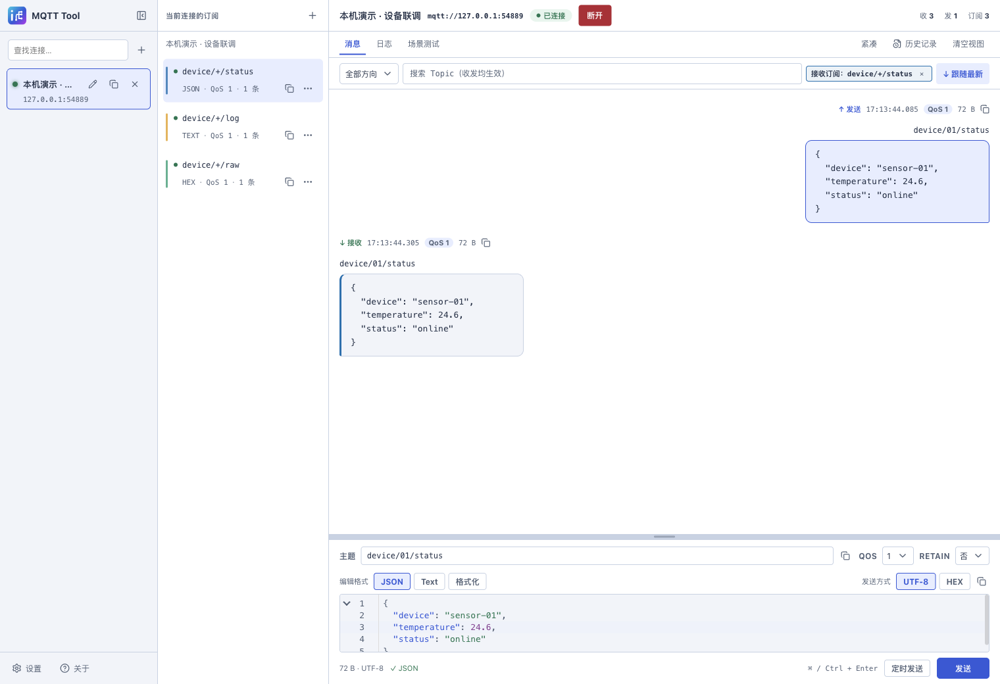

# MQTT Tool 快速上手

[返回首页](../README.md) · [下载安装](https://mqtt.ineedfull.com/downloads/) · [连接配置](connection-config.md)

本指南按当前仓库源码整理。官网安装包可能早于源码修复；请在「关于」核对版本及构建信息，具体下载文件的发布日期以下载页为准。

目标：连接一个测试 Broker，订阅三个主题，分别按 JSON、Text、HEX 查看自己发布的消息。第一次使用不需要真实设备。

## 1. 安装并准备 Broker

从下载页按操作系统、CPU 架构和 Electron / Tauri 选择安装包。Electron 自带 Chromium；Tauri 使用系统 WebView。已列出构建目标不等于该平台已经通过实机验收，签名和验证状态以下载页为准。

MQTT Tool 是客户端，需要另有 MQTT Broker。可以使用自己已有的测试 Broker；没有时，安装 Mosquitto，在本机终端运行：

```sh
mosquitto -p 18883
```

Mosquitto 2.x 未指定配置文件时使用本机访问模式。保持该终端运行；结束练习后用 Ctrl+C 停止。若端口被占用，换一个空闲端口，并同步修改下面的连接端口。

## 2. 新建测试连接

本机 Mosquitto 示例参数如下。远程服务请替换为管理员提供的真实参数。

| 参数 | 本机示例 |
| --- | --- |
| 连接名称 | 本机上手测试 |
| 连接方式 | MQTT，非 TLS、非 WebSocket |
| 主机 | `127.0.0.1`，不加 `mqtt://`、端口或路径 |
| 端口 | `18883` |
| Client ID | `ineed-first-run-01`，同时连接的客户端各自唯一 |
| 用户名、密码 | 上述无配置本机示例留空；真实服务按要求填写 |

保存并连接，确认连接状态成功，再添加订阅。

## 3. 同一个连接，三种消息格式

为下面三条订阅分别选择显示格式。先订阅成功，再发布；消息格式属于每条订阅，不需要为三种格式建立三个 Broker 连接。

| 订阅主题 | 订阅显示格式 | 发布主题 | 发布格式与载荷 |
| --- | --- | --- | --- |
| `ineed/demo/telemetry` | JSON | `ineed/demo/telemetry` | JSON：`{"temperature":25,"online":true}` |
| `ineed/demo/log` | Text | `ineed/demo/log` | Text：`hello MQTT` |
| `ineed/demo/raw` | HEX | `ineed/demo/raw` | HEX：`01 03 00 FF` |

首次练习使用 QoS 0、关闭 Retain、手动发送。选择对应订阅查看接收消息：JSON 可读结构化数据，Text 显示文字，HEX 应有四个原始字节 `01 03 00 FF`。发送 HEX 文本字符串与按 HEX 发送原始字节不同，记得核对发送格式。

这证明客户端发布、Broker 转发和本连接接收已走通。它还不能证明真实设备已经执行命令。后续用[设备消息场景](message-scenarios.md)关联请求 ID、响应主题和业务断言，验证设备回复。



## 4. 遇到问题先查这里

| 现象 | 检查方法 |
| --- | --- |
| 连接被拒绝或超时 | 确认 Broker 正在运行、主机和端口正确；本机示例不要改成 TLS 或 WebSocket |
| 连上后反复掉线 | 确认其他客户端没有使用相同 Client ID；再检查服务端认证与日志 |
| 能发送却收不到 | 确认订阅成功、发布主题与订阅匹配、账号具有订阅权限；本例不要使用通配符作发布主题 |
| 收到了但显示不对 | 检查该条订阅的显示格式和发送格式；二进制先用 HEX 核对字节 |
| 场景超时但消息已发出 | 发布成功不等于业务成功；核对响应主题、请求 ID 原样返回和断言，见场景指南 |
| 看到界面但无法真实连接 | 确认使用桌面版；浏览器渲染预览不能代替原生连接 |

## 5. 保存与反馈

连接、订阅和消息历史与设备场景报告是不同的数据。场景需要单独保存，导出报告前确认本轮结果；数据保留和导出边界见[场景指南](message-scenarios.md)与[开发指南](development.md)。

仍有问题，可在 [GitHub Issues](https://github.com/ineedfull/ineed-mqtt-tool/issues) 或 [Gitee Issues](https://gitee.com/ineedfull/ineed-mqtt-tool/issues) 反馈。请提供：应用版本、Electron/Tauri、系统及架构、连接方式、脱敏主题与载荷、复现步骤、预期/实际结果；卡死时说明进程是否仍在。不要公开密码、Token、私钥或客户数据；安全漏洞按[安全报告](../SECURITY.md)私下反馈。
